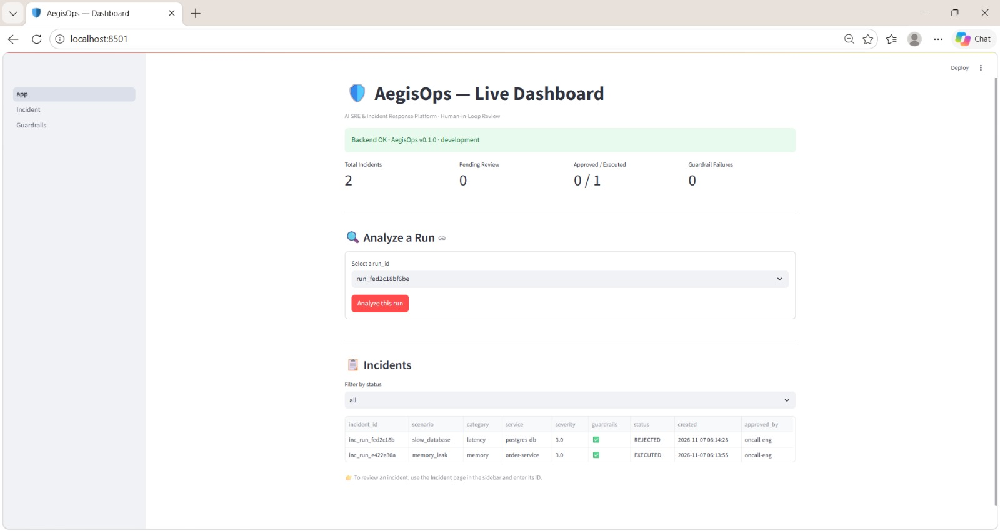
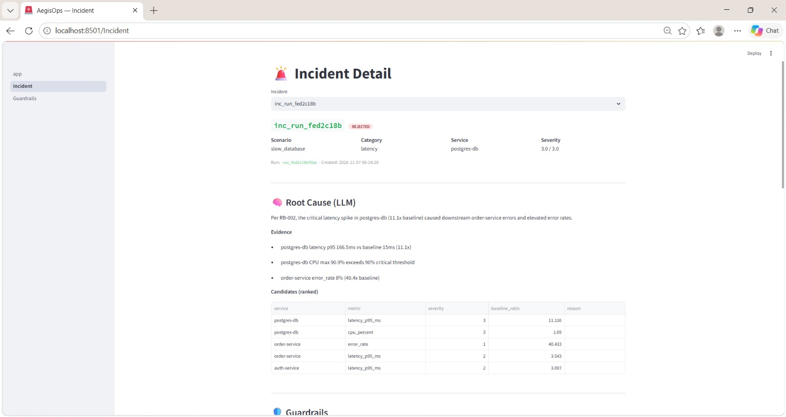
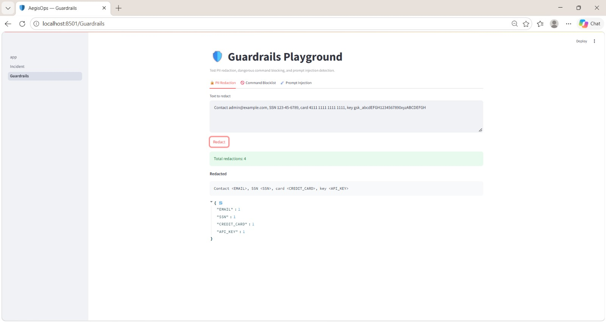

# 🛡️ AegisOps — AI-Powered SRE & Incident Response Platform

> **An autonomous AI teammate for Site Reliability Engineering (SRE)** that detects infrastructure anomalies, investigates incidents using multi-agent LLM reasoning and internal runbooks, and recommends safe remediations with human approval.

<p align="center">
  
  
  
  
  
  
  
</p>

<p align="center">
  <b>AI Agents · Anomaly Detection · Hybrid RAG · LLM Security · Human-in-the-Loop · MLOps · Observability</b>
</p>

---

## 📸 Screenshots

### Dashboard


### Incident Analysis


### Security Guardrails


## 📌 Overview

AegisOps is an AI-powered Site Reliability Engineering (SRE) platform designed to automate infrastructure incident investigation and response.

Traditional incident management often requires engineers to manually inspect metrics, logs, traces, dashboards, and internal documentation. This process can be slow, especially during critical production incidents.

AegisOps brings these capabilities together into one intelligent workflow.

It uses:

- **Isolation Forest** for infrastructure anomaly detection.
- **LangGraph** to orchestrate six specialized AI agents.
- **Groq LLM (`gpt-oss-120b`)** for structured incident reasoning.
- **Hybrid RAG** to retrieve relevant internal SRE runbooks.
- **Five-layer security guardrails** to validate proposed actions.
- **Human-in-the-loop approval** before remediation execution.
- **Prometheus and MLflow** for monitoring and experiment tracking.

The platform includes a simulated infrastructure environment with six microservices and multiple incident scenarios.

## 🎯 Problem Statement

Infrastructure incidents can cause downtime, degraded performance, failed requests, and operational losses.

SRE teams typically need to:

1. Identify unusual infrastructure behavior.
2. Inspect metrics, logs, and traces.
3. Find the root cause.
4. Search internal runbooks.
5. Decide on a safe remediation.
6. Execute and monitor the recovery.

These steps can consume significant engineering time.

**AegisOps aims to reduce this manual investigation effort** by combining anomaly detection, AI agents, retrieval-augmented generation, security controls, and human approval into a unified incident-response workflow.

## ✨ Key Features

### 1. Intelligent Anomaly Detection

- Isolation Forest-based anomaly detection.
- Baseline-aware feature engineering.
- Rolling statistics and Z-score-based features.
- Detection across simulated infrastructure services.
- Supports multiple incident scenarios.

Features include:

- `value_ratio`
- `zscore`
- `rolling_mean_ratio`
- `rolling_std_ratio`
- `delta_zscore`

### 2. Six-Agent AI Investigation Pipeline

AegisOps uses LangGraph to coordinate six specialized agents.

| Agent | Responsibility |
|---|---|
| Metric Agent | Investigates infrastructure metrics |
| Log Agent | Analyzes application and system logs |
| Trace Agent | Examines request traces |
| Runbook Agent | Retrieves relevant internal documentation |
| Reasoner Agent | Combines evidence and determines likely root cause |
| Remediation Agent | Proposes a suitable corrective action |

The agents work together to produce a structured incident analysis.

### 3. Hybrid RAG System

AegisOps uses Retrieval-Augmented Generation (RAG) to ground incident reasoning in internal SRE documentation.

**Retrieval pipeline:**

1. Runbook parsing
2. BM25 keyword retrieval
3. ChromaDB vector retrieval
4. Reciprocal Rank Fusion (RRF)
5. Cross-encoder reranking
6. Relevant runbook context passed to the LLM

This helps the system connect incident evidence with relevant operational procedures.

### 4. Five-Layer AI Security

Security is a core part of the remediation workflow.

| Layer | Security Mechanism |
|---|---|
| 1 | PII redaction |
| 2 | Dangerous command blocker |
| 3 | Safe command allowlist |
| 4 | Role-Based Access Control (RBAC) |
| 5 | Prompt injection detection |

Additional protections include:

- Blocking dangerous shell commands.
- Restricting permitted `kubectl` command patterns.
- Detecting sensitive information.
- Enforcing role-based permissions.
- Identifying suspicious prompt instructions.

### 5. Human-in-the-Loop Remediation

AegisOps does not automatically execute proposed remediation actions.

The workflow follows:

`pending → approved → executed`

An incident can also be rejected with a recorded reason.

Features:

- Approval and rejection workflow.
- Approver identity and timestamp.
- Audit trail.
- Dry-run command execution.
- Simulated Kubernetes execution.

**Human approval remains mandatory before remediation execution.**

### 6. Observability & MLOps

- Prometheus metrics for application and agent monitoring.
- MLflow experiment and model tracking.
- Structured logging using Structlog.
- LLM token and API cost tracking.
- Agent execution latency monitoring.
- Prompt version tracking.

---

## 🏗️ System Architecture

```text
             SIMULATED INFRASTRUCTURE
       ┌───────────────────────────────────┐
       │ Frontend · API · Auth · Order     │
       │ Payment · PostgreSQL              │
       └─────────────────┬─────────────────┘
                         │
                 Metrics / Logs / Traces
                         │
                         ▼
              ┌────────────────────┐
              │  Data Ingestion    │
              │  SQLite Storage    │
              └─────────┬──────────┘
                        │
                        ▼
              ┌────────────────────┐
              │ Isolation Forest   │
              │ Anomaly Detection  │
              └─────────┬──────────┘
                        │
                        ▼
              ┌────────────────────┐
              │ LangGraph Pipeline │
              │                    │
              │ 1. Metric Agent    │
              │ 2. Log Agent       │
              │ 3. Trace Agent     │
              │ 4. Runbook Agent   │
              │ 5. Reasoner Agent  │
              │ 6. Remediation     │
              └─────────┬──────────┘
                        │
              ┌─────────▼──────────┐
              │ Groq LLM + Hybrid  │
              │ RAG (ChromaDB)     │
              └─────────┬──────────┘
                        │
                        ▼
              ┌────────────────────┐
              │ Security Guardrails│
              │ PII · RBAC · CMD   │
              │ Injection Checks   │
              └─────────┬──────────┘
                        │
                        ▼
              ┌────────────────────┐
              │ Streamlit UI       │
              │ Human Approval     │
              └─────────┬──────────┘
                        │
                        ▼
              ┌────────────────────┐
              │ Dry-Run Execution  │
              │ Audit Trail        │
              └────────────────────┘

         Prometheus · MLflow · Structlog
```

## 📊 Measured Results

The following figures are from the project's supplied six-scenario evaluation and test results.

| Evaluation Metric | Reported Result |
|---|---:|
| Category Accuracy | 100% (6/6 scenarios) |
| Service Accuracy | 100% (6/6 scenarios) |
| Metric Accuracy | 100% (6/6 scenarios) |
| RAG Precision | 100% |
| Average End-to-End Latency | ~26.73 seconds |
| Cost per Incident | ~$0.0011 |
| Automated Tests | 66/66 passing |
| Guardrail Block Rate | 100% in tested cases |

**Important:** These are results from the project's simulated scenarios and test environment. They should not be interpreted as independently validated production performance.

### Incident Evaluation

| Scenario | Predicted Category | Result |
|---|---|---|
| Normal | Healthy | Passed |
| Memory Leak | Memory | Passed |
| Slow Database | Latency | Passed |
| Service Outage | Errors | Passed |
| CPU Spike | CPU | Passed |
| Error Cascade | Errors | Passed |

## 🧰 Technology Stack

| Category | Technologies |
|---|---|
| Programming | Python 3.11+ |
| Backend | FastAPI, Uvicorn |
| AI Agents | LangGraph, LangChain |
| LLM | Groq — gpt-oss-120b |
| Machine Learning | Scikit-learn, Isolation Forest |
| RAG | ChromaDB, BM25, Sentence Transformers |
| Reranking | Cross-Encoder |
| Data Validation | Pydantic v2 |
| Database | SQLite, SQLAlchemy |
| Frontend | Streamlit, Plotly |
| Monitoring | Prometheus, Structlog |
| Experiment Tracking | MLflow |
| Testing | Pytest |
| Deployment | Docker, Docker Compose |

---

## 🚀 Getting Started

### Prerequisites

- Python 3.11 or newer
- Git
- Groq API key
- Docker Desktop (optional)

### 1. Clone the Repository

```bash
git clone https://github.com/vaibhav07772/aegisops.git
cd aegisops
```

### 2. Create a Virtual Environment

**Windows:**

```bash
python -m venv .venv
.venv\Scripts\activate
```

**Linux / macOS:**

```bash
python3 -m venv .venv
source .venv/bin/activate
```

### 3. Install Dependencies

```bash
pip install -r requirements-dev.txt
```

### 4. Configure Environment Variables

Create your environment file:

```bash
cp .env.example .env
```

On Windows Command Prompt, you can use:

```cmd
copy .env.example .env
```

Add your Groq API key to `.env`:

```env
GROQ_API_KEY=your_groq_api_key_here
```

Get an API key from:

https://console.groq.com/keys

**Never commit your `.env` file or expose API keys publicly.**

### 5. Initialize Runbooks and Simulation Data

Run the project bootstrap commands:

```bash
python scripts/setup_runbooks.py --force

python scripts/run_simulation.py --scenario normal --duration 30 --speedup 10

python scripts/run_simulation.py --scenario memory_leak --duration 30 --speedup 10

python scripts/run_simulation.py --scenario slow_database --duration 30 --speedup 10

python scripts/run_simulation.py --scenario service_outage --duration 30 --speedup 10

python scripts/run_simulation.py --scenario cpu_spike --duration 30 --speedup 10

python scripts/run_simulation.py --scenario error_cascade --duration 30 --speedup 10

python scripts/ingest_data.py

python scripts/ingest_runbooks.py --force

python scripts/train_anomaly.py
```

### 6. Start the Application

Start the FastAPI backend:

```bash
python run.py
```

API documentation:

http://localhost:8000/docs

Open another terminal, activate the same virtual environment, and start Streamlit:

```bash
streamlit run admin/app.py
```

Dashboard:

http://localhost:8501

### 7. Run with Docker (Optional)

Configure `.env` with your Groq API key, then run:

```bash
docker-compose up --build
```

---

## 🎬 Demo Workflow

Try the following workflow in the application:

1. Open the Streamlit dashboard.
2. Select an available incident from the incident queue.
3. Click **Analyze this run**.
4. Observe the six-agent investigation pipeline.
5. Review the identified issue and retrieved runbook.
6. Inspect the proposed remediation.
7. Approve or reject the recommendation.
8. Review the execution result and audit trail.
9. Open the Guardrails page to test command validation.

Example security checks:

```bash
rm -rf /var/data
```

Expected: blocked by the dangerous command guardrail.

```bash
kubectl get pods
```

Expected: permitted when it matches the configured safe-command policy.

---

## 🧪 Testing

Run the complete test suite:

```bash
pytest -v
```

The supplied project results report **66 passing tests**.

| Test Module | Coverage | Tests |
|---|---|---:|
| `test_sim.py` | Telemetry simulation | 4 |
| `test_ingestion.py` | SQLite ingestion | 3 |
| `test_anomaly.py` | Anomaly detection | 5 |
| `test_agents.py` | Agent orchestration | 4 |
| `test_llm.py` | LLM integration and fallback | 9 |
| `test_rag.py` | Runbook retrieval | 5 |
| `test_security.py` | Security and guardrails | 30 |
| `test_evaluation.py` | Evaluation metrics | 6 |
| **Total** | | **66** |

## 📈 Run Evaluation

Execute:

```bash
python scripts/evaluate_system.py
```

The evaluation script checks incident category prediction, service identification, metric consistency, RAG retrieval, latency, and API cost.

---

## 🛡️ Security Design Principles

AegisOps follows several important design principles:

- **Least Privilege:** Users receive permissions based on their assigned roles.
- **Defense in Depth:** Multiple security layers validate inputs and actions.
- **Human Oversight:** Proposed remediation requires human approval.
- **Safe Execution:** Dry-run mode simulates commands rather than performing real infrastructure changes.
- **Auditability:** Approval and execution events are recorded.
- **Resilience:** Rule-based fallback supports operation when LLM reasoning is unavailable.

---

## 💡 Key Engineering Decisions

### 1. LLM + Rule-Based Fallback

LLM services can fail or become unavailable. A rule-based fallback provides an alternative inference path when LLM reasoning cannot be completed.

### 2. Hybrid Retrieval Instead of Vector Search Alone

Combining BM25 keyword search with vector retrieval helps retrieve runbooks using both exact operational terms and semantic similarity.

### 3. Structured LLM Outputs

Pydantic validation is used to validate structured JSON responses and normalize outputs before downstream processing.

### 4. Human Approval Before Remediation

The remediation workflow separates recommendation from execution. This reduces the risk of blindly executing AI-generated commands.

### 5. Security at the Action Boundary

Proposed commands are checked against security policies before they reach the execution workflow.

---

## 📁 Project Structure

```text
aegisops/
│
├── app/
│   ├── agents/             # Six-agent LangGraph pipeline
│   ├── api/                # FastAPI routes and endpoints
│   ├── evaluation/         # Ground truth and evaluation
│   ├── llm/                # Groq client, prompts and schemas
│   ├── ml/                 # Isolation Forest and features
│   ├── pipeline/           # Telemetry ingestion
│   ├── rag/                # Hybrid retrieval and runbooks
│   ├── security/           # Security guardrails
│   ├── storage/            # Database models and repositories
│   └── monitoring/         # Prometheus metrics
│
├── admin/                  # Streamlit dashboard
├── sim/                    # Infrastructure simulator
├── scripts/                # Setup, training and evaluation
├── tests/                  # Automated tests
├── data/runbooks/          # SRE runbook documents
├── docs/screenshots/       # Project screenshots
│
├── Dockerfile
├── docker-compose.yml
├── requirements-dev.txt
├── .env.example
├── run.py
└── README.md
```

---

## 🚧 Limitations & Future Improvements

Potential next steps for the project include:

- Integration with real Kubernetes clusters.
- Real Prometheus and Grafana infrastructure telemetry.
- Production-grade persistent incident storage.
- More diverse real-world incident datasets.
- Expanded evaluation across larger scenario sets.
- Additional authentication and authorization integrations.
- Deployment to a cloud environment.
- More advanced incident correlation and root-cause analysis.

The current project uses simulated infrastructure and dry-run remediation. It should not be treated as a production incident-response system without additional testing, security review, and operational integrations.

---

## 🧠 What This Project Demonstrates

AegisOps demonstrates practical engineering skills across several AI and software domains:

- Python backend engineering.
- Machine Learning and anomaly detection.
- Generative AI and LLM integration.
- Multi-agent systems using LangGraph.
- Retrieval-Augmented Generation (RAG).
- Hybrid search and reranking.
- Structured output validation.
- AI security and prompt injection defense.
- Human-in-the-loop workflows.
- MLOps and experiment tracking.
- Monitoring and observability.
- API development using FastAPI.
- Docker-based application packaging.
- Automated testing and evaluation.

---

## 👨‍💻 Author

**Vaibhav Singh**

Aspiring AI/ML Engineer | GenAI & Agentic AI Developer

- GitHub: [@vaibhav07772](https://github.com/vaibhav07772)
- Project: [AegisOps](https://github.com/vaibhav07772/aegisops)

---

## 📄 License

This project is licensed under the MIT License. See the `LICENSE` file for details.

---

<p align="center">
  <b>Built with ❤️, Python, LangGraph, FastAPI and Groq.</b>
  <br/>
  <i>Making incident response smarter, safer and faster.</i>
</p>